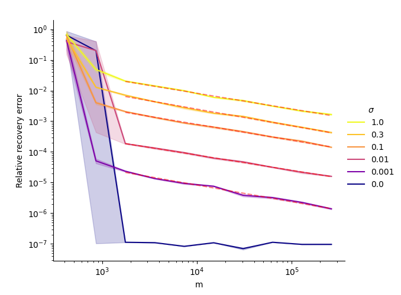
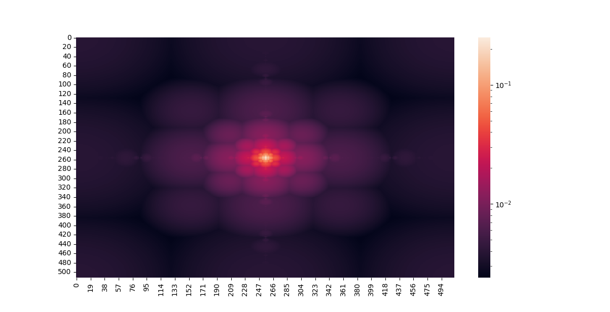

# Sparse adapted denoising

Numerical experiments for compressed sensing with subsampled Fourier measurements, with sparse (wavelet) and generative (VAE) priors. The code compares sampling schemes (uniform, optimized with-replacement, without-replacement, and optimized Bernoulli selectors, which combine deterministic and random row selection) and measures how recovery error falls as the number of measurements grows, with and without noise.

## Papers

This code produced the numerical experiments in:

- Y. Plan, M. S. Scott, X. Sheng, Ö. Yılmaz. *Denoising guarantees for optimized sampling schemes in compressed sensing.* SIAM Journal on Mathematics of Data Science, 2026. [arXiv:2504.01046](https://arxiv.org/abs/2504.01046)
- Y. Plan, M. S. Scott, Ö. Yılmaz. *Partially deterministic sampling for compressed sensing with denoising guarantees.* [arXiv:2604.04802](https://arxiv.org/abs/2604.04802)

## Plots

Relative recovery error against the number of measurements `m` for wavelet-sparse images, under an optimized sampling scheme, for several noise levels `σ`. Dashed lines are least-squares fits: the error caused by noise decays as `m` grows.



Local coherences of the 2D Fourier basis with respect to Haar wavelets (log scale, zero frequency at the centre). The optimized sampling schemes favour rows with high coherence (with-replacement probabilities are proportional to their squares).



## Layout

- `sparse_recov/sampling_recov_functions.py`: subsampled Fourier operators and their adjoints, sampling distributions (with replacement, without replacement, optimized Bernoulli) and preconditioners.
- `sparse_recov/uneven_sparse_experiment.py`: the sparse-prior experiment (wavelet-sparse images, Haar local coherences).
- `sparse_recov/sparse_uniform_experiment.py`, `sparse_recov/subspace_prior.py`: further sparse and subspace-prior experiments.
- `sparse_recov/generative.py`, `sparse_recov/optimization.py`, `sparse_recov/train_model.py`, `sparse_recov/convvae/`: generative priors (VAE on CelebA), their Fourier local coherences, and recovery by optimizing over the latent space.
- `sparse_recov/data_analysis.py`: log-log least-squares fits and faceted plots.
- `plots/`: notebooks that make the figures.
- `tests/`: pytest tests.

## Running

Each experiment module exports `make_df()`, a pandas DataFrame with one row per run configuration, and `experiment(row)`, which runs one row and returns its results. The rows run in parallel, locally or on a Slurm cluster, with [Experiments_on_Slurm](https://github.com/mscott99/Experiments_on_Slurm), whose `utils` package must be on the Python path.

```sh
pip install -r local_requirements.txt
python run_local.py   # results go to data/last_sparse.pickle
pytest tests/
```

`run_server.sh <branch>` checks out a branch on a remote machine, runs `run_server.py` there and copies the resulting DataFrame back as a pickle. Its paths are set for the author's machines.
